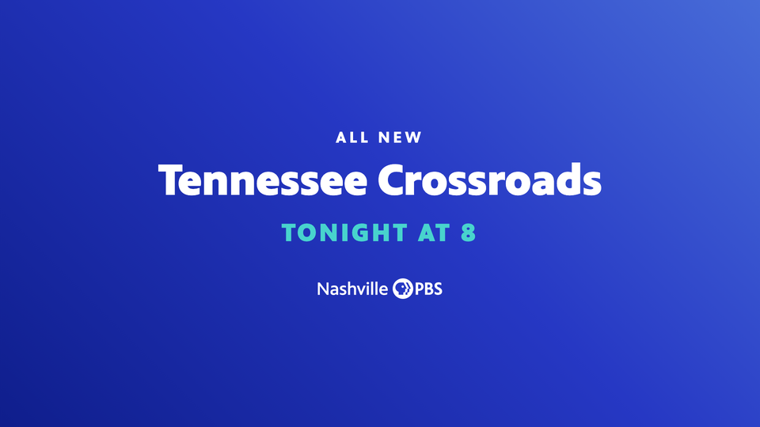
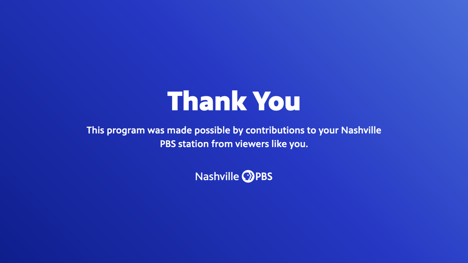
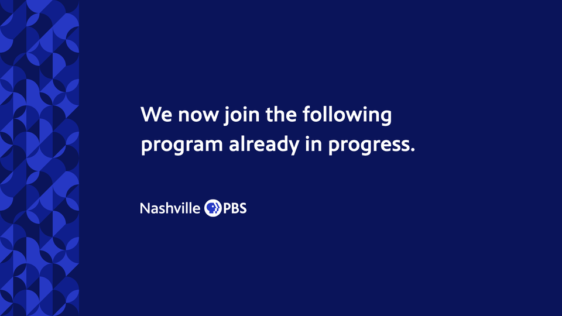
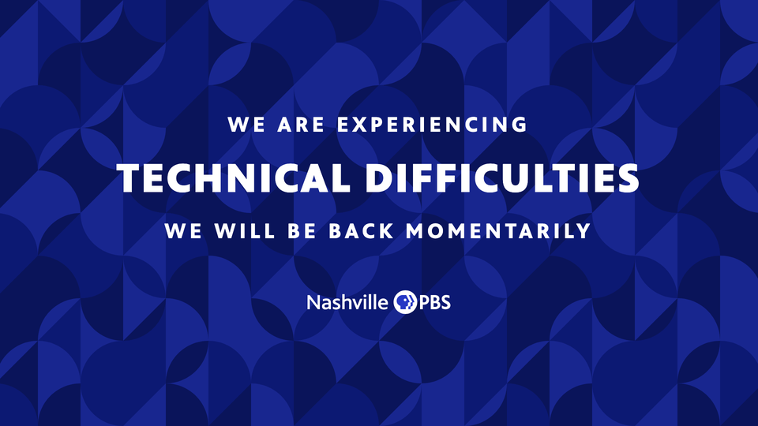
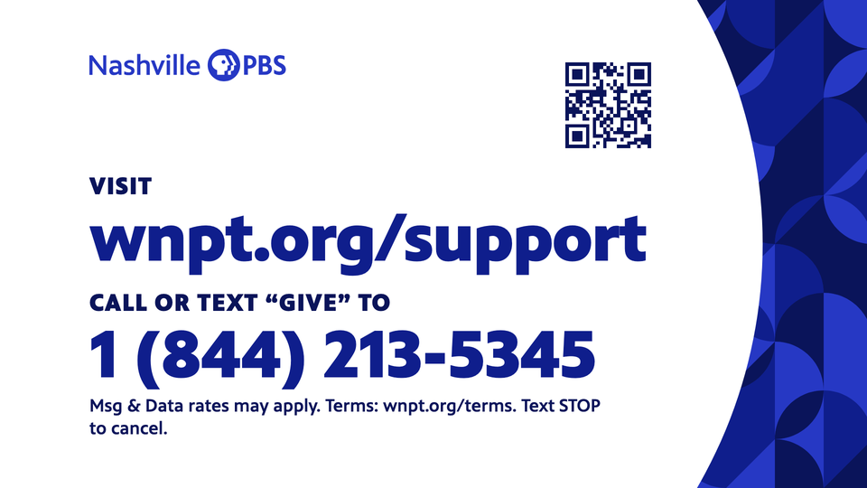

# BUILD-endcards.md — on-air end cards in Lower Thirds Studio

Spec and decision record for the End Cards generator at `endcards/`. Written 2026-11-06 for Shane
Burkeen; the rules come from the live Design System (mirror `NashvillePBS/design-system`, commit
`a6761a8`): the brand book's Broadcast section, the six `broadcast-*.card.html` guideline cards, the
`BroadcastEndpage` / `BroadcastSlates` / `BroadcastTitleCard` / `BroadcastSafeAreas` previews and the
October 2026 On-Air template (`templates/on-air/OnAir.dc.html`). Where this build departs from the
template, §6 says so and why.

**Status:** the engine, the tool page and the verification harness exist and pass (§8). What is still
open is Shane's call on which styles ship first and where the tool is hosted (§10). Nothing is linked
from the studio's picker yet.

---

## 1. What it is and where it lives

A producer picks an end-card style, fills its fields, and downloads the frame as a PNG at HD
(1920×1080) and UHD (3840×2160). The preview and the export are the same DOM (build.md §1.2), built by
one function in `endcards/endcards.js`.

| Path | What |
|---|---|
| `endcards/index.html` | The tool: studio-style header, fields, preview with safe-area guides, downloads. Plain HTML and JS, **no dc runtime, no bundle, no patcher**: edit it directly, like `pledge/` (build.md §13.8). |
| `endcards/endcards.js` | The builder, config (`CONFIG`), the style table (`STYLES`), fit, export. |
| `endcards/assets/` | The brand SVGs, copied from the design-system mirror's asset store: both lockups, both patterns, the five channel marks (the mirror's `assets/channels/README.md` says to copy the folder beside the page). |
| `endcards/vendor/` | `html-to-image` 1.11.11 (the version the studio pins) and `qrcode-generator` 1.4.4, vendored with hashes in `NOTICE.md` so exports do not depend on a CDN. |
| `endcards/selftest.html` + `scripts/endcards-harness.mjs` + `scripts/verify-endcards.py` | Headless verification (§8). |
| `endcards/samples/` | Half-size renders of every style from the real export pipeline (§9). |

Why a sibling page and not a studio screen: the studio's `.dc.html` can only be changed through the
dist patcher, hunk by hunk; a 1920×1080 generator with four layouts would be the largest patch ever
taken for no producer-facing gain, and the sibling-page pattern is the one that has shipped twice
(Pledge Graphics, Business Essentials). The studio gets one card in its Misc section linking to
`endcards/`, the same one-line touch point the other two have.

Why no Airtable: like Station ID (build.md §5), end cards are station assets, not tied to a Series or
Content record. Download only. Saving them would need the Graphics table direction in build.md §13.3,
which is its own decision.

## 2. The set

Four styles now; three more are a config entry each if wanted (§2.5).

### 2.1 Endpage

Top-right Primary Gradient (`--gradient-primary-tr`, 225°). Centred inside title-safe. Co-brand
lockup at the foot. Covers the promo endpage ("ALL NEW / Tennessee Crossroads / TONIGHT AT 8") and,
with the text field, the end-of-program cards (funding line, "viewers like you", production credit).

| Field | Renders as | Rule |
|---|---|---|
| Strand | 40px PBS Sans Bold, .2em tracking, ALL CAPS, white | optional |
| Title | 112px Black, −.01em, one line per typed line, each line fits to 1520px | lines never auto-wrap (build.md §1.6) |
| Qualifier | 40px Medium, white at 85% | optional |
| Funding or credits text | 40px Medium, line-height 1.4, wraps at 1280px, explicit line breaks kept | optional; the 40px floor is the rule, not a choice |
| Tune-in | 64px Black, .1em, ALL CAPS, **the accent** | optional; with TONIGHT the tool flags "pm" |
| Co-brand | white lockup, shield 52px tall, 80px below the last line | station, WORLD, Create, ALL ARTS, PBS KIDS, Passport |

Defaults: ALL NEW / Tennessee Crossroads / TONIGHT AT 8. Everything but the title collapses when empty.

### 2.2 Slate

Navy field, the **Community pattern as a left rail** (Shane's 2026-11-06 call, design-system
`shane.md` 4), message left-aligned beside it, station lockup under the message. "We now join…",
"Please stand by", network-difficulty notices in sentence case.

| Field | Renders as |
|---|---|
| Message | 72px Medium, line-height 1.4, wraps at 1150px, typed line breaks kept; block starts at x=480 (25%), ends at title-safe right |
| Lockup | white station logo, 60px, left-aligned under the message, 140px gap |

### 2.3 Announcement slate

Three ALL CAPS lines centred on the **full Community field** with the brand book's 50% Navy overlay
(copy over a Pattern needs an overlay of 50% or more). "WE ARE EXPERIENCING / TECHNICAL DIFFICULTIES /
WE WILL BE BACK MOMENTARILY."

| Field | Renders as |
|---|---|
| Top line | 54px Bold, .18em |
| Main line | 104px Black, .05em, 44px above and below |
| Bottom line | 54px Bold, .18em, optional |
| Lockup | white station logo, 60px, 120px below |

### 2.4 Support end card

White circle field over the Community pattern (station practice: "donation End Cards: white
circle-crop field over pattern, VISIT url + CALL OR TEXT number + QR"). Content column x 198–1472,
color station lockup top-left (72px), QR top-right (250px), the pitch bottom-aligned.

| Field | Renders as | Default (carried from the October template, **to be fact-checked**, shane.md 3) |
|---|---|---|
| Address label | 54px Black, .04em, ALL CAPS, Navy | VISIT |
| Web address | 150px Black, Medium Blue, fits to 1274px | wnpt.org/support |
| Phone label | 54px Black, ALL CAPS, Navy | CALL OR TEXT "GIVE" TO |
| Phone number | 150px Black, Medium Blue | 1 (844) 213-5345 |
| Fine print | 40px Medium, Navy, two lines at most | Msg & Data rates may apply. Terms: wnpt.org/terms. Text STOP to cancel. |
| QR code | made from `https://` + the address, Navy on white, error level M, 4-module quiet zone; or an uploaded image | generated |

### 2.5 Not built, one config entry each if Shane wants them

From the same October template, with its field sets: **Notice / In memoriam** (eyebrow in the accent,
name, dates line, accent rule, details lines, optional circle portrait, logo bottom-left), **Title card**
(one headline with one highlighted word in the accent), **Show promo** (title with one bold word, two
detail lines). Each is a `STYLES` entry plus a builder function of about 15 lines. The Credits
generator already covers credit rolls.

## 3. Safe-area geometry (from `broadcast-safe-areas.card.html` and the Broadcast section)

Frame 16:9, authored at 1920×1080, exported at 2× for the 3840×2160 UHD master; never DCI 4K. Every
readable element (text, logos, QR) inside title-safe, no exceptions; backgrounds, the rail and the
circle bleed to the edges. 4:3 center-cut is ignored.

| | HD 1920×1080 | UHD 3840×2160 |
|---|---|---|
| Title-safe, inner 80% (inset 10%) | (192, 108) to (1728, 972); 1536×864 | (384, 216) to (3456, 1944) |
| Action-safe, inner 90% (inset 5%) | (96, 54) to (1824, 1026) | (192, 108) to (3648, 2052) |
| Minimum type | 40px (3.7% of frame height) | 80px (the same DOM at 2×) |

How each style uses it: the endpage and announcement slate centre a 1536×864 box placed exactly on
title-safe; the slate's text block runs from x=480 to x=1728 and y=108 to 972; the support card's column
runs x=198–1472 and y=108–972 (6px in from the left edge so a glyph's side bearing cannot cross it).
The preview draws both boxes; the export never does. The harness proves it with pixel reads (§8).

## 4. Type, color and the other rules applied

- **PBS Sans only**, the four weights the repo ships (Regular 400, Medium 500, Bold 700, Black 800),
  self-hosted from `fonts/`; Arial is the fallback only if a font fails to load, and the tool flags a
  failed asset load instead of exporting around it.
- **One accent per card**: Teal (default), Yellow, Coral or White, on the tune-in line only. Blues from
  the tokens: PBS Blue `#2638C4`, Navy `#0A145A`, Medium Blue `#0F1E8C`, Light Blue `#486CD8`. No
  neutrals, no secondary accents, no shadows, no Curve.
- **Backgrounds** switch per card between the top-right gradient, a Pattern field, the Pattern rail and
  solid Navy; the Pattern switches between Community and Insight. Defaults per style: endpage gradient;
  slates and the support card Community (station practice, Broadcast section).
- **Pattern scale** follows the brand book's Patterns section: whole rows, 3 to 6 in the area, centred
  and cropped on the other axis. The full field shows 5 rows (cells of 216px, tile 1296px, the sides crop
  evenly). The rail is 270px wide (14% of the frame, the `BroadcastSlates` preview) and holds 3 whole
  columns (cells of 90px, 12 whole rows), the book's minimum.
- **ALL CAPS** for the strand, tune-in, the announcement lines and the support labels; the tool
  upper-cases them so producers type normally. Tune-in with TONIGHT never carries "pm": the tool warns.
- **Fit**: single display lines shrink to their width and stop at 40px; past that the tool reports the
  line and blocks the download. Multi-line text wraps inside title-safe; anything that still crosses
  the box is reported and blocks the download.

## 5. Config, not rewrites

The two open art-direction calls in the design-system `shane.md` and every number that is taste
rather than rule sit in `CONFIG` / `STYLES` at the top of `endcards/endcards.js`:

| Decision | Where | Today |
|---|---|---|
| Slate background (shane.md 4) | `STYLES.slate.background`, `.pattern`; `STYLES['slate-caps']` likewise | `pattern-rail` + `community` (Shane, 2026-11-06); `pattern` + `community` with overlay |
| PBS KIDS on screen (shane.md 5) | `CONFIG.channels.kids.file` | the paired digital file, color PBS KIDS beside the white station logo (October rule); swap the file for a reverse treatment |
| Fine print size | `CONFIG.finePrint` | 40 (the on-air minimum; the template said 29) |
| Pattern rows in a field / columns in the rail | `CONFIG.fieldRows`, `CONFIG.railColumns`, `CONFIG.railWidth` | 5 / 3 / 270 |
| Overlay over a pattern that carries text | `CONFIG.overlay` | 0.5 Navy |
| The support circle | `CONFIG.circle` | diameter 2150, centre (614, 540) |
| QR | `CONFIG.qr` | 250px, quiet zone 4, level M, Navy |
| Which lockup files, and their shield height share | `CONFIG.channels` | shield 52px on the endpage for every channel |

## 6. Where this departs from the October template, and why

1. **The support circle is a circle.** The template drew a 2150×1771 box with `border-radius:50%`, an
   ellipse. Circles are the signature shape; the field is now a true circle of diameter 2150 centred at
   (614, 540), which still covers the whole content column inside title-safe (checked: at y=108 the
   circle reaches x=1598, the column ends at 1472).
2. **Fine print at 40px, in Navy.** The template set 29px in `#10173A`. The station rule is a 40px
   minimum and the palette has no `#10173A`; both are config if Shane overrules (§5).
3. **Rail at 3 whole columns, field at 5 whole rows.** The template tiled the rail at one column and
   the field at 4.5 rows with slivers; the brand book asks for whole rows or columns, 3 to 6, no
   slivers. The look is the `BroadcastSlates` preview's, at the book's scale.
4. **Co-brand lockups sized by shield height**, so WORLD, Create, ALL ARTS, PBS KIDS and Passport all
   put the station shield at 52px; the template capped them by box instead.
5. **Title lines never auto-wrap**; producers break them (the studio's rule for secondary lines,
   build.md §1.6). The template shrank the whole title on one line.
6. **QR made in the tool** from the address rather than dropped in, with upload as the exception.
7. **Vendored libraries** instead of the CDN, so a bad network cannot take the export away mid-production.

## 7. Export

- HD: the stage captured at `pixelRatio: 1, width: 1920, height: 1080`, as the credits pages are.
- UHD: the same node under a real `transform: scale(2)` captured at 3840×2160 (`captureAtScale`,
  the studio's 2026-08-05 fix), so text is painted at the target resolution, not upscaled.
- Fonts settle (`document.fonts.ready`), images load, then a double `requestAnimationFrame`, then
  capture (build.md §4's credits rule).
- Opaque RGBA PNGs (these carry their background; nothing is keyed). Names follow build.md §1.10's
  slug rules: `<style>-<first line of the main field>-<WxH>.png`, for example
  `endpage-tennessee-crossroads-1920x1080.png`, `support-wnpt-org-support-3840x2160.png`.
- Downloads are blocked while a warning stands (a line that cannot fit, text outside title-safe, a
  missing image, "pm" after TONIGHT), the Business Essentials rule.

## 8. Verification

`python3 scripts/verify-endcards.py --samples` serves the repo on a local port, drives
`endcards/selftest.html` in headless Chrome over the DevTools protocol (`scripts/endcards-harness.mjs`),
and for every style exports the frame through the real pipeline twice at each size: in full, and with
every readable element hidden but still laid out. The pixels that differ are the ink. The script
checks the export size, that the ink's bounding box sits inside title-safe, that every fitted line is
at least 40px, that the PNG is opaque, and that the export raised no warning. Run on 2026-11-06:

```
PBS Sans loaded in the harness: True
style            export     ink bbox (l,t,r,b)           title-safe                   min px  result
endpage          1920x1080  (400, 333, 1519, 756)        (192, 108, 1728, 972)        40      ok
endpage          3840x2160  (800, 667, 3037, 1512)       (384, 216, 3456, 1944)       40      ok
endpage-funding  1920x1080  (355, 371, 1564, 750)        (192, 108, 1728, 972)        112     ok
endpage-funding  3840x2160  (712, 742, 3127, 1500)       (384, 216, 3456, 1944)       112     ok
slate            1920x1080  (480, 361, 1416, 741)        (192, 108, 1728, 972)        None    ok
slate            3840x2160  (960, 723, 2832, 1482)       (384, 216, 3456, 1944)       None    ok
slate-caps       1920x1080  (295, 296, 1618, 796)        (192, 108, 1728, 972)        54      ok
slate-caps       3840x2160  (590, 593, 3235, 1592)       (384, 216, 3456, 1944)       54      ok
support          1920x1080  (197, 108, 1442, 962)        (192, 108, 1728, 972)        54      ok
support          3840x2160  (395, 216, 2883, 1923)       (384, 216, 3456, 1944)       54      ok
ALL OK
```

(The endpage's 40px is the strand line, set at 40px by design, not a shrink. "None" means the slate
has no single-line element; its message wraps.)

## 9. Samples (half size, from the export pipeline)

| | |
|---|---|
| Endpage, tune-in<br> | Endpage, funding text<br> |
| Slate<br> | Announcement slate<br> |
| Support end card<br> | |

## 10. Open for Shane (batched)

1. **Which styles ship first.** All four above are built and verified; the three in §2.5 are not.
   Say which of the four go live now and whether any of the three should follow.
2. **Hosting.** Today the studio, this page, the PBS Sans files and the picker are public at
   nashvillepbs.github.io/wnpt-lowerthird. The other staff tools live on wnpt.app subdomains behind
   Cloudflare Access (Entra, @wnpt.org). Moving the whole studio means: a Worker serving the repo's
   static files on a wnpt.app name, an Access application for it, `ALLOW_ORIGIN` on the Airtable proxy
   changed to the new origin (one dashboard variable; the proxy allows one origin), the old Pages URL
   left as a redirect, and the brand page linking to the new address. Consequences: producers sign in
   with their station account once; anyone outside @wnpt.org (a freelance editor) needs to be added to
   the Access policy; the font files leave the public web. The end-card page itself talks to no backend,
   so it works at either address unchanged. Recommendation: move, as its own session after this one;
   until then the brand page links to the Pages URL.
3. **Support-card facts** (shane.md 3): the address, the text-to-give number and keyword, and the
   terms line are the October template's defaults, not verified by this session.
4. **Art direction defaults** (§5): fine print at 40px, rail at 3 columns, field at 5 rows, PBS KIDS
   file. Silence keeps them.

## 11. What is left after the answer

Enable the picked styles (drop the others from `STYLES` or leave them; one line each), add the End
Cards card to the studio's Misc grid through the patcher, mirror `dist/` to the root, push, verify the
deployed page end to end in a browser (a real download at both sizes), close the docs (build.md §13.10
pointer, SESSIONS.md "Completed", PROGRESS.md, shane.md), and tell the brand-page session the URL.
