# BUILD-graphics.md — end cards, event signs and the move to graphics.wnpt.app

Spec and decision record for the two generators added to Lower Thirds Studio in November 2026 and for
the studio's move off public GitHub Pages. The studio started as lower thirds; Shane now calls it the
station's graphics studio, on-air and print, and this document treats it that way.

The rules come from the live Design System (mirror `NashvillePBS/design-system`, commit `cbbcf67`):
for the end cards the brand book's Broadcast section, the six `broadcast-*.card.html` guideline
cards, the `BroadcastEndpage` / `BroadcastSlates` / `BroadcastTitleCard` / `BroadcastSafeAreas`
previews and the October 2026 On-Air template (`templates/on-air/OnAir.dc.html`); for the signs the
Logo, Color, Typography, Graphic Elements and Print sections, `tokens.json` and the flier template.
Where a build departs from a template, the section says so and why.

**Status (2026-11-07):** both generators exist and pass their verifiers (§A8, §B8); the PowerPoint
PowerPoint templates were removed at Shane's direction (§B10). The studio's picker links both generators (Shane, 2026-11-07: one
card each; the pages keep their own pickers). Waiting on Shane: whether sponsor logos belong on signs,
the support card's facts and the photography notice wording (Part C). The hosting move
(Part D) is live: https://graphics.wnpt.app/ since 2026-11-07, evidence in `PROGRESS.md`.

---

# Part A. End cards (`endcards/`)

## A1. What it is and where it lives

A producer picks an end-card style, fills its fields, and downloads the frame as a PNG at HD
(1920×1080) and UHD (3840×2160). The preview and the export are the same DOM (build.md §1.2), built by
one function in `endcards/endcards.js`.

| Path | What |
|---|---|
| `endcards/index.html` | The tool: studio-style header, fields, preview with safe-area guides, downloads. Plain HTML and JS, **no dc runtime, no bundle, no patcher**: edit it directly, like `pledge/` (build.md §13.8). |
| `endcards/endcards.js` | The builder, config (`CONFIG`), the style table (`STYLES`), fit, export. |
| `endcards/assets/` | The brand SVGs, copied from the design-system mirror's asset store: both lockups, both patterns, the five channel marks (the mirror's `assets/channels/README.md` says to copy the folder beside the page). |
| `shared/studio-core.js` | The capture pipeline both generators share: element helpers, line fitting, the readable-element check, fonts-images-frames settling, capture at scale (PNG or canvas). |
| `vendor/` | `html-to-image` 1.11.11 (the version the studio pins) and `qrcode-generator` 1.4.4, vendored with hashes in `NOTICE.md` so exports do not depend on a CDN. |
| `endcards/selftest.html` + `scripts/endcards-harness.mjs` + `scripts/verify-endcards.py` | Headless verification (§A8). |
| `endcards/samples/` | Half-size renders of every style from the real export pipeline (§A9). |

Why a sibling page and not a studio screen: the studio's `.dc.html` can only be changed through the
dist patcher, hunk by hunk; a 1920×1080 generator with four layouts would be the largest patch ever
taken for no producer-facing gain, and the sibling-page pattern is the one that has shipped twice
(Pledge Graphics, Business Essentials). The studio gets one card in its Misc section linking to
`endcards/`, the same one-line touch point the other two have.

Why no Airtable: like Station ID (build.md §A5), end cards are station assets, not tied to a Series or
Content record. Download only. Saving them would need the Graphics table direction in build.md §13.3,
which is its own decision.

## A2. The set

Four styles now; three more are a config entry each if wanted (§A2.5).

### A2.1 Endpage

Top-right Primary Gradient (`--gradient-primary-tr`, 225°). Centred inside title-safe. Co-brand
lockup at the foot. Covers the promo endpage ("ALL NEW / Tennessee Crossroads / TONIGHT AT 8") and,
with the text field, the end-of-program cards (funding line, "viewers like you", production credit).

| Field | Renders as | Rule |
|---|---|---|
| Strand | 40px PBS Sans Bold, .2em tracking, ALL CAPS, white | optional |
| Title | 112px Black, −.01em, one line per typed line, each line fits to 1520px | lines never auto-wrap (build.md §1.6) |
| Qualifier | 40px Medium, white at 85% | optional |
| Funding or credits text | 40px Medium, line-height 1.4, wraps at 1280px, explicit line breaks kept | optional; the 40px floor is the rule, not a choice |
| Tune-in | 64px Black, .1em, ALL CAPS, **the accent** | optional; with TONIGHT the tool flags "pm" |
| Co-brand | white lockup, shield 52px tall, 80px below the last line | station, WORLD, Create, ALL ARTS, PBS KIDS, Passport |

Defaults: ALL NEW / Tennessee Crossroads / TONIGHT AT 8. Everything but the title collapses when empty.

### A2.2 Slate

Navy field, the **Community pattern as a left rail** (Shane's 2026-11-06 call, design-system
`shane.md` 4), message left-aligned beside it, station lockup under the message. "We now join…",
"Please stand by", network-difficulty notices in sentence case.

| Field | Renders as |
|---|---|
| Message | 72px Medium, line-height 1.4, wraps at 1150px, typed line breaks kept; block starts at x=480 (25%), ends at title-safe right |
| Lockup | white station logo, 60px, left-aligned under the message, 140px gap |

### A2.3 Announcement slate

Three ALL CAPS lines centred on the **full Community field** with the brand book's 50% Navy overlay
(copy over a Pattern needs an overlay of 50% or more). "WE ARE EXPERIENCING / TECHNICAL DIFFICULTIES /
WE WILL BE BACK MOMENTARILY."

| Field | Renders as |
|---|---|
| Top line | 54px Bold, .18em |
| Main line | 104px Black, .05em, 44px above and below |
| Bottom line | 54px Bold, .18em, optional |
| Lockup | white station logo, 60px, 120px below |

### A2.4 Support end card

White circle field over the Community pattern (station practice: "donation End Cards: white
circle-crop field over pattern, VISIT url + CALL OR TEXT number + QR"). Content column x 198–1472,
color station lockup top-left (72px), QR top-right (250px), the pitch bottom-aligned.

| Field | Renders as | Default (carried from the October template, **to be fact-checked**, shane.md 3) |
|---|---|---|
| Address label | 54px Black, .04em, ALL CAPS, Navy | VISIT |
| Web address | 150px Black, Medium Blue, fits to 1274px | wnpt.org/support |
| Phone label | 54px Black, ALL CAPS, Navy | CALL OR TEXT "GIVE" TO |
| Phone number | 150px Black, Medium Blue | 1 (844) 213-5345 |
| Fine print | 40px Medium, Navy, two lines at most | Msg & Data rates may apply. Terms: wnpt.org/terms. Text STOP to cancel. |
| QR code | made from `https://` + the address, Navy on white, error level M, 4-module quiet zone; or an uploaded image | generated |

### A2.5 Not built, one config entry each if Shane wants them

From the same October template, with its field sets: **Notice / In memoriam** (eyebrow in the accent,
name, dates line, accent rule, details lines, optional circle portrait, logo bottom-left), **Title card**
(one headline with one highlighted word in the accent), **Show promo** (title with one bold word, two
detail lines). Each is a `STYLES` entry plus a builder function of about 15 lines. The Credits
generator already covers credit rolls.

## A3. Safe-area geometry (from `broadcast-safe-areas.card.html` and the Broadcast section)

Frame 16:9, authored at 1920×1080, exported at 2× for the 3840×2160 UHD master; never DCI 4K. Every
readable element (text, logos, QR) inside title-safe, no exceptions; backgrounds, the rail and the
circle bleed to the edges. 4:3 center-cut is ignored.

| | HD 1920×1080 | UHD 3840×2160 |
|---|---|---|
| Title-safe, inner 80% (inset 10%) | (192, 108) to (1728, 972); 1536×864 | (384, 216) to (3456, 1944) |
| Action-safe, inner 90% (inset 5%) | (96, 54) to (1824, 1026) | (192, 108) to (3648, 2052) |
| Minimum type | 40px (3.7% of frame height) | 80px (the same DOM at 2×) |

How each style uses it: the endpage and announcement slate centre a 1536×864 box placed exactly on
title-safe; the slate's text block runs from x=480 to x=1728 and y=108 to 972; the support card's column
runs x=198–1472 and y=108–972 (6px in from the left edge so a glyph's side bearing cannot cross it).
The preview draws both boxes; the export never does. The harness proves it with pixel reads (§A8).

## A4. Type, color and the other rules applied

- **PBS Sans only**, the four weights the repo ships (Regular 400, Medium 500, Bold 700, Black 800),
  self-hosted from `fonts/`; Arial is the fallback only if a font fails to load, and the tool flags a
  failed asset load instead of exporting around it.
- **One accent per card**: Teal (default), Yellow, Coral or White, on the tune-in line only. Blues from
  the tokens: PBS Blue `#2638C4`, Navy `#0A145A`, Medium Blue `#0F1E8C`, Light Blue `#486CD8`. No
  neutrals, no secondary accents, no shadows, no Curve.
- **Backgrounds** switch per card between the top-right gradient, a Pattern field, the Pattern rail and
  solid Navy; the Pattern switches between Community and Insight. Defaults per style: endpage gradient;
  slates and the support card Community (station practice, Broadcast section).
- **Pattern scale** follows the brand book's Patterns section: whole rows, 3 to 6 in the area, centred
  and cropped on the other axis. The full field shows 5 rows (cells of 216px, tile 1296px, the sides crop
  evenly). The rail is 270px wide (14% of the frame, the `BroadcastSlates` preview) and holds 3 whole
  columns (cells of 90px, 12 whole rows), the book's minimum.
- **ALL CAPS** for the strand, tune-in, the announcement lines and the support labels; the tool
  upper-cases them so producers type normally. Tune-in with TONIGHT never carries "pm": the tool warns.
- **Fit**: single display lines shrink to their width and stop at 40px; past that the tool reports the
  line and blocks the download. Multi-line text wraps inside title-safe; anything that still crosses
  the box is reported and blocks the download.

## A5. Config, not rewrites

The two open art-direction calls in the design-system `shane.md` and every number that is taste
rather than rule sit in `CONFIG` / `STYLES` at the top of `endcards/endcards.js`:

| Decision | Where | Today |
|---|---|---|
| Slate background (shane.md 4) | `STYLES.slate.background`, `.pattern`; `STYLES['slate-caps']` likewise | `pattern-rail` + `community` (Shane, 2026-11-06); `pattern` + `community` with overlay |
| PBS KIDS on screen (shane.md 5) | `CONFIG.channels.kids.file` | the paired digital file, color PBS KIDS beside the white station logo (October rule); swap the file for a reverse treatment |
| Fine print size | `CONFIG.finePrint` | 40 (the on-air minimum; the template said 29) |
| Pattern rows in a field / columns in the rail | `CONFIG.fieldRows`, `CONFIG.railColumns`, `CONFIG.railWidth` | 5 / 3 / 270 |
| Overlay over a pattern that carries text | `CONFIG.overlay` | 0.5 Navy |
| The support circle | `CONFIG.circle` | diameter 2150, centre (614, 540) |
| QR | `CONFIG.qr` | 250px, quiet zone 4, level M, Navy |
| Which lockup files, and their shield height share | `CONFIG.channels` | shield 52px on the endpage for every channel |

## A6. Where this departs from the October template, and why

1. **The support circle is a circle.** The template drew a 2150×1771 box with `border-radius:50%`, an
   ellipse. Circles are the signature shape; the field is now a true circle of diameter 2150 centred at
   (614, 540), which still covers the whole content column inside title-safe (checked: at y=108 the
   circle reaches x=1598, the column ends at 1472).
2. **Fine print at 40px, in Navy.** The template set 29px in `#10173A`. The station rule is a 40px
   minimum and the palette has no `#10173A`; both are config if Shane overrules (§A5).
3. **Rail at 3 whole columns, field at 5 whole rows.** The template tiled the rail at one column and
   the field at 4.5 rows with slivers; the brand book asks for whole rows or columns, 3 to 6, no
   slivers. The look is the `BroadcastSlates` preview's, at the book's scale.
4. **Co-brand lockups sized by shield height**, so WORLD, Create, ALL ARTS, PBS KIDS and Passport all
   put the station shield at 52px; the template capped them by box instead.
5. **Title lines never auto-wrap**; producers break them (the studio's rule for secondary lines,
   build.md §1.6). The template shrank the whole title on one line.
6. **QR made in the tool** from the address rather than dropped in, with upload as the exception.
7. **Vendored libraries** instead of the CDN, so a bad network cannot take the export away mid-production.

## A7. Export

- HD: the stage captured at `pixelRatio: 1, width: 1920, height: 1080`, as the credits pages are.
- UHD: the same node under a real `transform: scale(2)` captured at 3840×2160 (`captureAtScale`,
  the studio's 2026-08-05 fix, now `StudioCore.capturePng`), so text is painted at the target resolution, not upscaled.
- Fonts settle (`document.fonts.ready`), images load, then a double `requestAnimationFrame`, then
  capture (build.md §4's credits rule).
- Opaque RGBA PNGs (these carry their background; nothing is keyed). Names follow build.md §1.10's
  slug rules: `<style>-<first line of the main field>-<WxH>.png`, for example
  `endpage-tennessee-crossroads-1920x1080.png`, `support-wnpt-org-support-3840x2160.png`.
- Downloads are blocked while a warning stands (a line that cannot fit, text outside title-safe, a
  missing image, "pm" after TONIGHT), the Business Essentials rule.

## A8. Verification

`python3 scripts/verify-graphics.py --samples` serves the repo on a local port, drives
`endcards/selftest.html` in headless Chrome over the DevTools protocol (`scripts/endcards-harness.mjs`),
and for every style exports the frame through the real pipeline twice at each size: in full, and with
every readable element hidden but still laid out. The pixels that differ are the ink. The script
checks the export size, that the ink's bounding box sits inside title-safe, that every fitted line is
at least 40px, that the PNG is opaque, and that the export raised no warning. Run on 2026-11-07, after the move to the shared capture core (the numbers are unchanged from 2026-11-06):

```
end card            export     ink bbox (l,t,r,b)           title-safe                   min px  result
endpage          1920x1080  (400, 333, 1519, 756)        (192, 108, 1728, 972)        40      ok
endpage          3840x2160  (800, 667, 3037, 1512)       (384, 216, 3456, 1944)       40      ok
endpage-funding  1920x1080  (355, 371, 1564, 750)        (192, 108, 1728, 972)        112     ok
endpage-funding  3840x2160  (712, 742, 3127, 1500)       (384, 216, 3456, 1944)       112     ok
slate            1920x1080  (480, 361, 1416, 741)        (192, 108, 1728, 972)        None    ok
slate            3840x2160  (960, 723, 2832, 1482)       (384, 216, 3456, 1944)       None    ok
slate-caps       1920x1080  (295, 296, 1618, 796)        (192, 108, 1728, 972)        54      ok
slate-caps       3840x2160  (590, 593, 3235, 1592)       (384, 216, 3456, 1944)       54      ok
support          1920x1080  (197, 108, 1442, 962)        (192, 108, 1728, 972)        54      ok
support          3840x2160  (395, 216, 2883, 1923)       (384, 216, 3456, 1944)       54      ok
```

(The endpage's 40px is the strand line, set at 40px by design, not a shrink. "None" means the slate
has no single-line element; its message wraps.)

## A9. Samples (half size, from the export pipeline)

| | |
|---|---|
| Endpage, tune-in<br>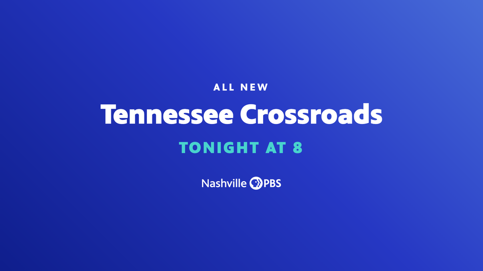 | Endpage, funding text<br>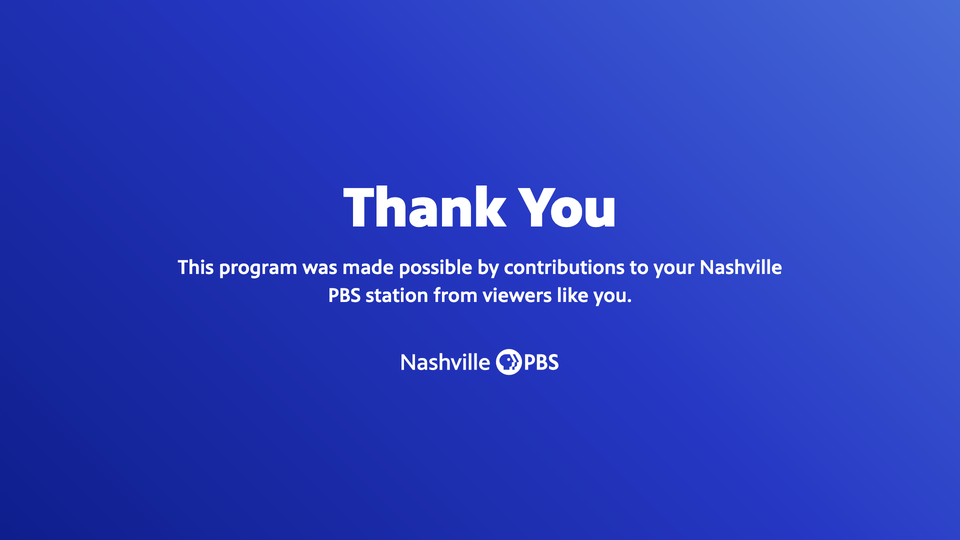 |
| Slate<br>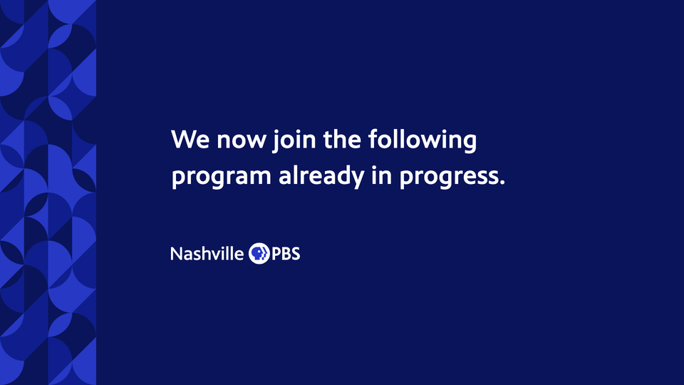 | Announcement slate<br>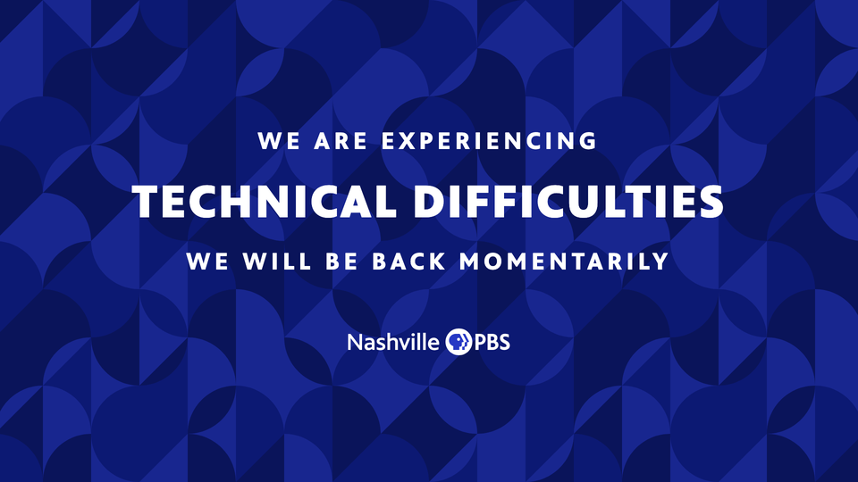 |
| Support end card<br>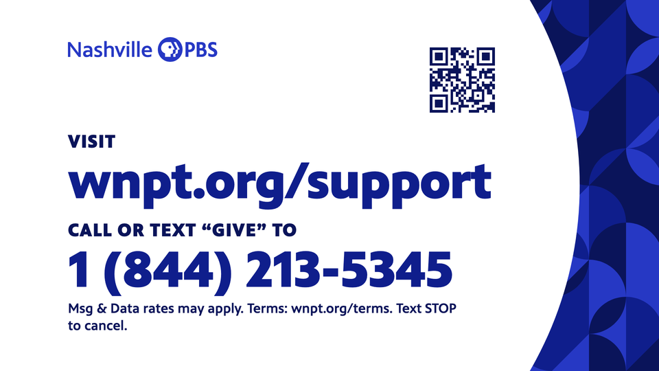 | |


---

# Part B. Event signs (`signs/`)

## B1. What it is and where it lives

A staffer picks a sign, fills its lines, chooses the paper (Letter or Tabloid, portrait or landscape)
and downloads a print-ready PDF. Same shape as the end cards: a sibling page, no runtime, the same
capture core, download only.

| Path | What |
|---|---|
| `signs/index.html` | The tool: sign cards, the four lines, paper and look controls, preview with the print margin, PDF and PNG downloads. |
| `signs/signs.js` | The builder, `CONFIG` (every taste value), `SIGNS` (the set), the fit, the PDF writer. |
| `signs/assets/` | The two station lockups. |
| `signs/selftest.html` | The headless harness's cases (§B8). |
| `signs/samples/` | Quarter-size renders of the PDF image for each case (§B9). |

## B2. The set

Ten signs. Eight share one layout and six fields: **headline** (one or two typed lines), **second
line**, **small text**, **arrow** (none, or one of eight directions), **partner label** and **partner
logos** (any number of logo files; see the partner row in §B3); the custom sign adds a web address and
a QR code. Two more have their own layouts: **Donate** and **Our Apps** (Shane, 2026-11-07). Every
sign is one entry in `SIGNS`.

| Sign | Default lines | Arrow |
|---|---|---|
| Welcome | Welcome / event name | no |
| Directional | Registration | right |
| Reserved | Reserved / for whom | no |
| Registration | Check-In | no |
| Restrooms | Restrooms | right |
| Quiet Please | Quiet Please / Recording in progress | no |
| Photography Notice | Attention / This event is being photographed and/or video recorded. / the station's approved paragraphs and "Thank you!" (Shane, 2026-11-07) | no |
| Custom | empty; a QR code when a web address is given, with a button that makes a new wnpt.tv short link for it | optional |
| Donate | Donate / "Donate at least $5 per month or $60 per year and enjoy Nashville PBS Passport" (the amounts are fields, since the Passport price may change) / the Passport lockup / wnpt.org/donate large / the station's **fixed, tracked** QR code (`CONFIG.tracked.donate`; the printed address until it is set) | no |
| Our Apps | Get Our Apps / Watch on your phone, tablet and TV. / one block per app turned on: the PBS app (national PBS logo, GET THE FREE PBS APP) and the PBS KIDS app (PBS KIDS logo, GET THE FREE PBS KIDS VIDEO APP), each with its **fixed, tracked** QR code (`CONFIG.tracked.apps`); the fine print once when a call to action says "free". The Nashville PBS app is wired in behind `enabled: false` until it launches (Shane, 2026-11-07) | no |

Paper: Letter 8.5×11 and Tabloid 11×17, portrait or landscape. Field: **White by default** (Navy
type, color logo), because these signs are printed in-house on the office color printer and a Navy
page eats its ink (Shane, 2026-11-07); Navy (white type, white logo) stays as the option for a print
shop or a sign holder. Accent: Yellow (the print register's accent), Teal or Coral, on the band only.

## B3. Geometry

Authored at 96 dpi, the brand book's Print register measure (Letter 816×1056 px). Tabloid is the Letter
layout scaled by 11/8.5 with the extra height given to the copy. Values at Letter, in `CONFIG`:

| Element | Value |
|---|---|
| Accent band | full width, 28px (0.29 in) at the top: a fill, never type (one accent per sign) |
| Text block | 64px (0.67 in) from the sides, 64px below the band, 56px above the bottom; vertically centred between band and logo; left-aligned, never justified |
| Headline | 132px (99pt at Letter) PBS Sans Black, −.02em, line-height 1.02; wraps; shrinks only when a single word is wider than the column, to a floor of 56px (42pt) |
| Second line | 40px (30pt) Medium |
| Small text | 26px (19.5pt) Regular, line-height 1.45, 560px wide at most |
| Arrow | 260px portrait (below the text), 300px landscape (beside it); the accent on Navy, Navy on white; a rounded line arrow in the Lucide stroke the brand book names for icons |
| Partner logos | a flex row above the station logo, wrapping as logos are added: label (20px Medium, "Supported by"), then each logo at its own shape inside a box no taller than 64px and no wider than 220px for 1 to 3 logos, 52/170px for 4 to 6, 44/130px for 7 or more; gaps 28px across, 18px between rows; 36px above the row. Sponsor and underwriter marks stay smaller than the station lockup and carry a plain label, nothing that reads as an advertisement |
| QR code | 192px (2 in) at Letter, Navy modules on white, quiet zone 4, error level M; the address printed under it in 22px Bold. It encodes the wnpt.tv short link when one was made, otherwise https:// plus the address |
| Donate | headline 132px; the Passport sentence at 40px Medium; the Passport lockup 54px tall; the address 64px Black in PBS Blue; the QR beside the copy in landscape, under it in portrait |
| Our Apps | headline 96px (so three apps fit); each app a row of logo over call to action (22px Black, .04em, ALL CAPS) beside a 120px QR (112px in landscape) with its address under it; the PBS logo 70px, the station lockup 44px, the PBS KIDS logo 96px tall; blocks stacked in portrait, side by side in landscape; the fine print 18px once |
| Logo | white or color horizontal lockup, shield 40px (0.42 in; the print minimum is 0.2 in), bottom-left |
| Print margin | 0.5 in (48px): nothing readable crosses it. Office printers cannot print the outer 0.2 in; the Navy field bleeds to the edge and prints with a thin white edge that a sign holder hides |

## B4. Rules applied

PBS Sans only (Arial in the PowerPoint template, §B10). Navy, PBS Blue and white from the tokens; one
accent per sign, on the band only (an accent arrow on Navy is the same accent; on white the arrow is
Navy, since Yellow on white fails contrast). White on Navy and Navy on white both pass AA at 17:1.
Headlines bold with tight tracking, body regular, left-aligned. No shadows, gradients or effects. No
emoji; the one icon is the line arrow. The logo untouched, in its correct tone for the field.

## B5. Export

The PDF is one page at the exact paper size in points (Letter 612×792, Tabloid 792×1224) carrying one
FlateDecode RGB image: the sign's DOM captured at 300 dpi (Letter 2550×3300, Tabloid 3300×5100)
through `StudioCore.captureCanvas`, the pixels deflated in the browser (`CompressionStream`) and
wrapped by a 40-line PDF writer in `signs.js`; no PDF library. No bleed and no crop marks: the renderer
draws the trim size, as the task allowed. A 300 dpi PNG of the same frame is the second download, for
screens. Names: `sign-<headline>-<letter|tabloid>-<portrait|landscape>.pdf`. Downloads are blocked
while a warning stands (a word too long at the floor, copy taller than the sign, anything inside the
print margin, a missing image).

**Short links and QR codes.** The QR code is made in the page (`vendor/qrcode.js`, shared through
`StudioCore.qrSvgDataUrl`). On the Donate and Our Apps signs the code is locked to a tracked wnpt.tv link
that Shane sets once in `CONFIG.tracked` (his call, 2026-11-07: "lock down that QR code for those so I
can track in Google Analytics"), so nobody prints an untracked variant; an app with no tracked link yet
gets no code and the download is blocked. Only the custom sign makes new links: a "Make short link"
button next to the address asks the studio's own API,
`POST /api/shortlink` on graphics.wnpt.app (`src/graphics-worker.js`), which verifies the Cloudflare
Access login again and creates a wnpt.tv link in Short.io with the station's key, held as the Worker
secret `SHORTIO_API_KEY` that only Shane sets; the browser never sees the key. The QR then encodes the
short link and prints it under the code. Until the secret is set the API answers 503 and the QR uses
the full address; the page says so. Short.io is the same account and domain the web-sync Worker uses
(`wnpt.tv`), with its own copy of the key, because a Worker secret cannot be read back or shared.

Raster, not vector: Business Essentials draws its PDFs as vectors with embedded PBS Sans because
business cards go to a press. Signs are office-printed or quick-printed, and a 300 dpi raster prints
sharp at any sign-viewing distance; the 40-line writer has no dependencies and no font-embedding
license question. A vector path is a later upgrade if a press job ever needs it.

## B6. Where this departs from the templates, and why

The flier template (`templates/flier/`) is the nearest relative: Navy or pattern hero, white type, the
accent as a small label, the logo at the foot, 48px side padding on a Letter page. Signs take its
field, its padding and its logo placement, and leave out the pattern (signs are read at a glance from
across a room; the brand book keeps copy over a Pattern to a few words and under an overlay). The
full-width band is the brand book's "full-width solid Yellow or Navy bars for major section headings"
in the Documents register.

## B7. Config, not rewrites

Everything that is taste sits at the top of `signs/signs.js`: `CONFIG.band`, `padX`, `padTop`,
`padBottom`, `headline`, `subline`, `body`, `floor`, `logo`, `arrow`, `arrowUsesAccent`, `bodyMax`,
and the partner row's `CONFIG.partners` (label, label size, the three size tiers, gaps); the set in
`SIGNS`; the papers in `SIZES`; the accents in `ACCENTS`; the default field in `defaultState`.

## B8. Verification

The same verifier (`python3 scripts/verify-graphics.py --only signs`) drives `signs/selftest.html`:
nineteen cases across every sign, both papers, both orientations, both fields, the partner row
(three logos of different shapes; seven logos, wrapping tier), the donate sign, the app sign with three
apps and with two, and a custom sign with a QR code. For each it takes the
real PDF, parses its one image back out of the FlateDecode stream, checks the page size against the
paper and the image size against 300 dpi, diffs the image against a render of the same frame with the
readable elements hidden, and requires the ink's bounding box to sit inside the 0.5 in margin (150px
at 300 dpi), with no warning from the export. Run on 2026-11-07:

```
sign                             page, image                ink bbox (l,t,r,b)           0.5 in margin              min pt  result
welcome-letter-portrait          612x792 pt, 2550x3300 px   (200, 1259, 1920, 3125)      (150, 150, 2400, 3150)     30      ok
welcome-white-letter-landscape   792x612 pt, 3300x2550 px   (200, 962, 2463, 2375)       (150, 150, 3150, 2400)     30      ok
directional-letter-portrait      612x792 pt, 2550x3300 px   (200, 985, 2268, 3125)       (150, 150, 2400, 3150)     89      ok
directional-letter-landscape     792x612 pt, 3300x2550 px   (199, 919, 2931, 2375)       (150, 150, 3150, 2400)     80      ok
directional-tabloid-portrait     792x1224 pt, 3300x5100 px  (259, 1688, 2941, 4875)      (150, 150, 3150, 4950)     115     ok
directional-tabloid-landscape    1224x792 pt, 5100x3300 px  (259, 1062, 4677, 3075)      (150, 150, 4950, 3150)     128     ok
reserved-letter-portrait         612x792 pt, 2550x3300 px   (200, 1337, 1898, 3125)      (150, 150, 2400, 3150)     30      ok
registration-letter-portrait     612x792 pt, 2550x3300 px   (200, 1337, 1852, 3125)      (150, 150, 2400, 3150)     30      ok
restrooms-letter-portrait        612x792 pt, 2550x3300 px   (200, 994, 2204, 3125)       (150, 150, 2400, 3150)     99      ok
quiet-letter-portrait            612x792 pt, 2550x3300 px   (200, 1118, 1424, 3125)      (150, 150, 2400, 3150)     30      ok
photo-letter-portrait            612x792 pt, 2550x3300 px   (200, 1008, 2302, 3125)      (150, 150, 2400, 3150)     84      ok
custom-letter-landscape          792x612 pt, 3300x2550 px   (200, 978, 2504, 2375)       (150, 150, 3150, 2400)     30      ok
ALL OK
```

("min pt" is the smallest fitted line: the 30pt second line where one exists, otherwise the headline.)

## B9. Samples (quarter size, from the PDF's own image)

| | | |
|---|---|---|
| Welcome<br>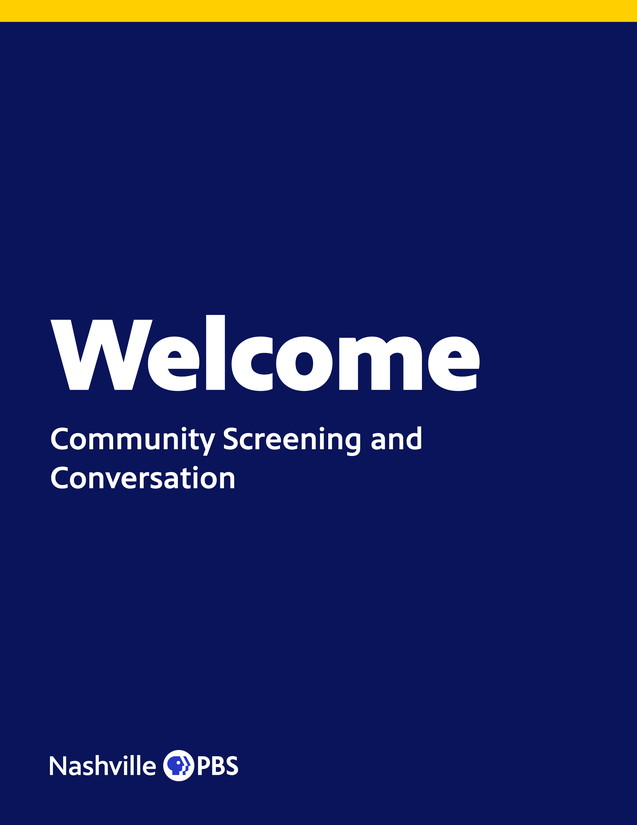 | Directional<br>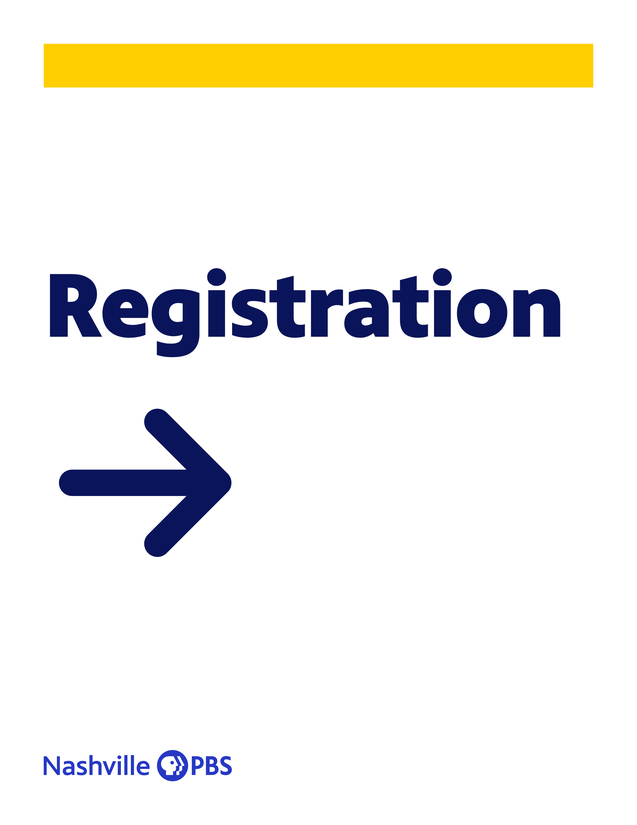 | Reserved<br>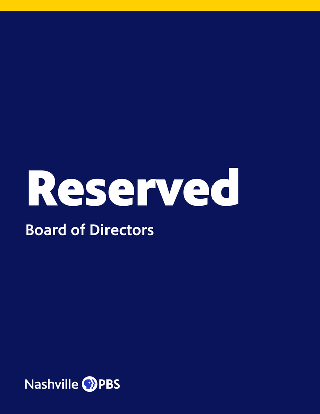 |
| Registration<br>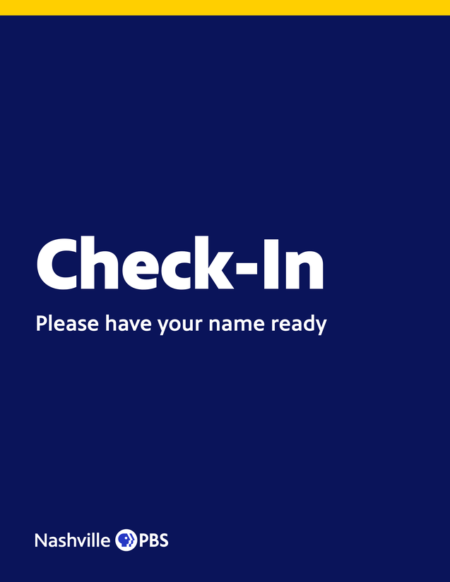 | Restrooms<br>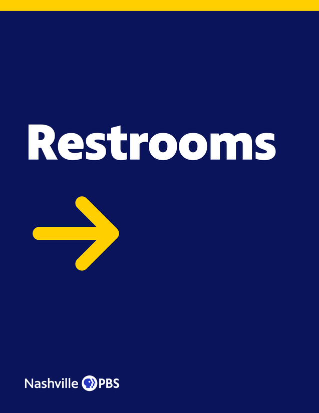 | Quiet Please<br>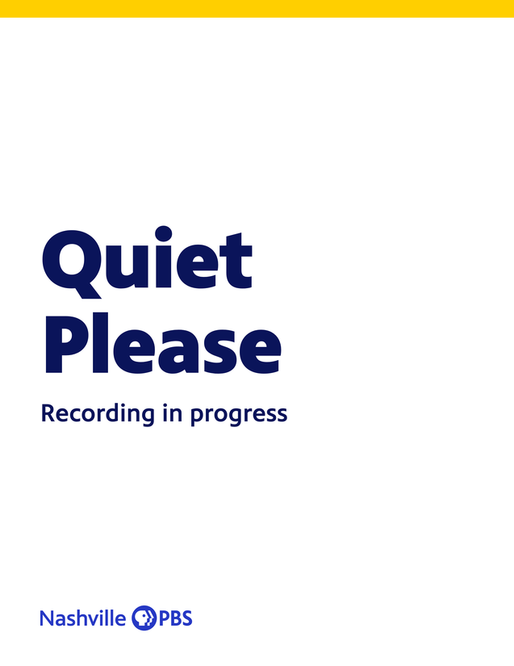 |
| Photography Notice<br>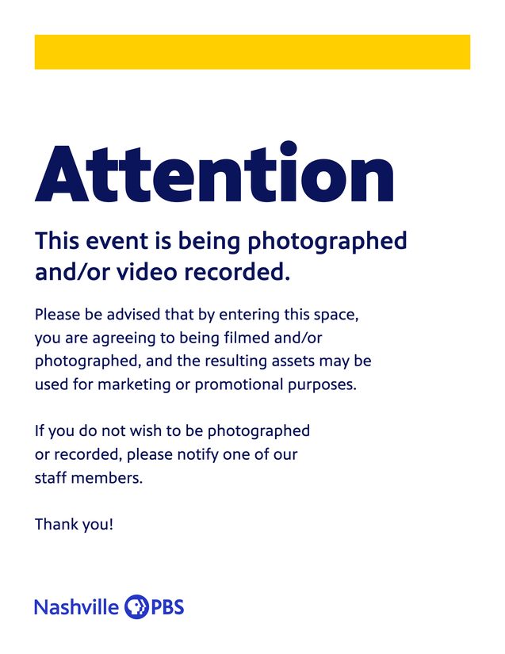 | Custom, landscape, Teal<br>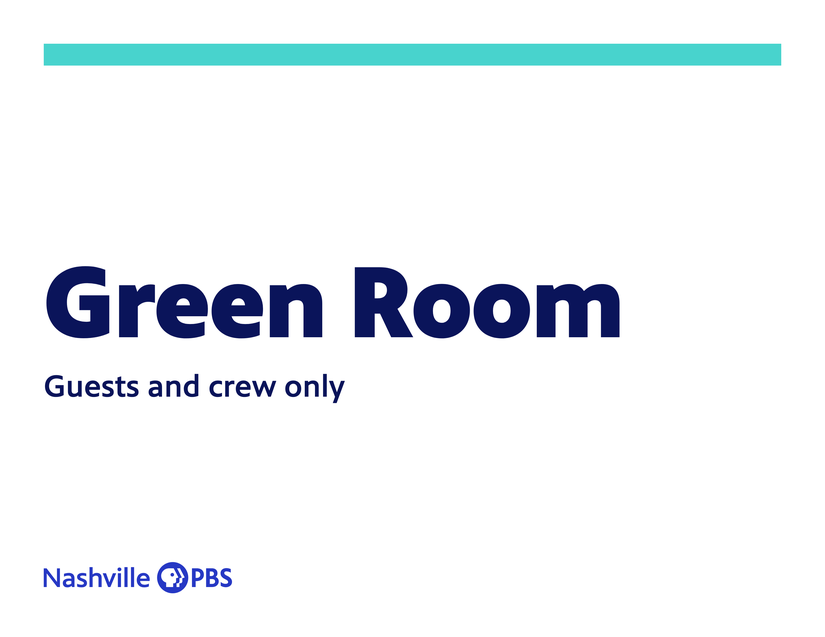 | Welcome, landscape<br>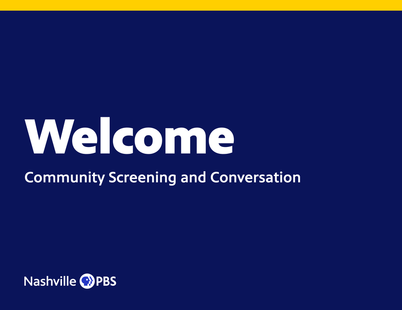 |
| Directional, Tabloid<br>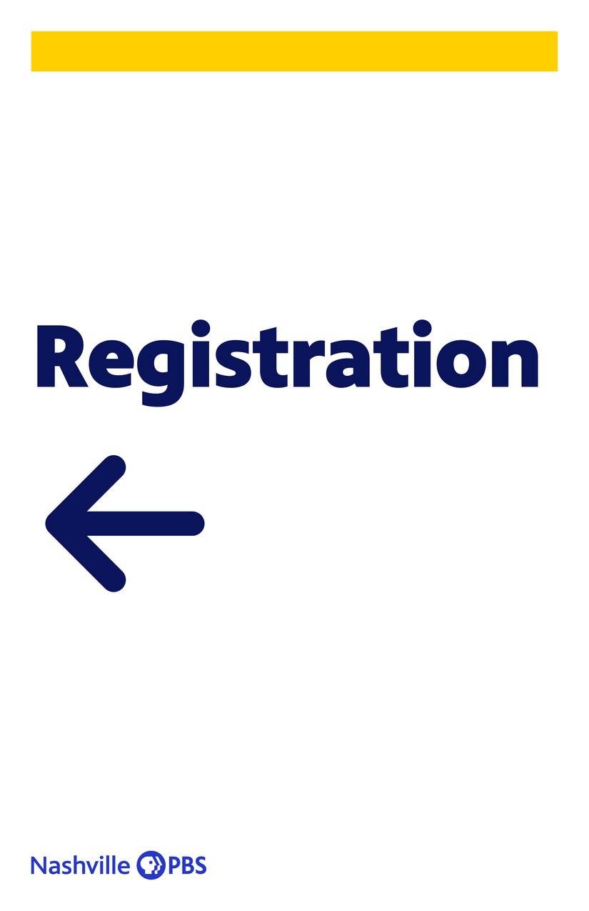 | Directional, Tabloid landscape<br>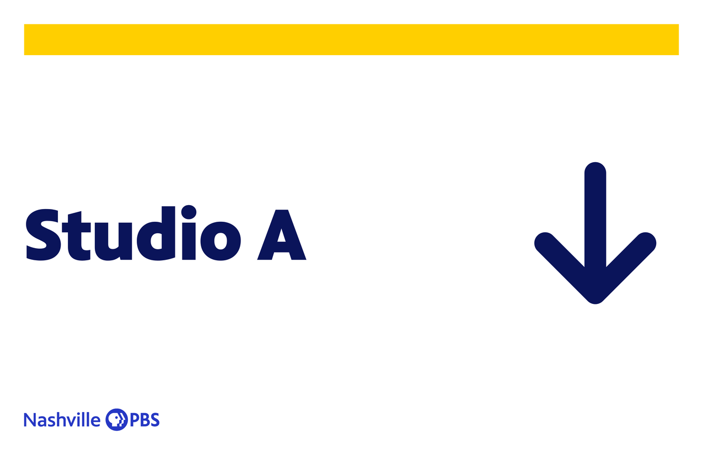 | Directional, landscape<br>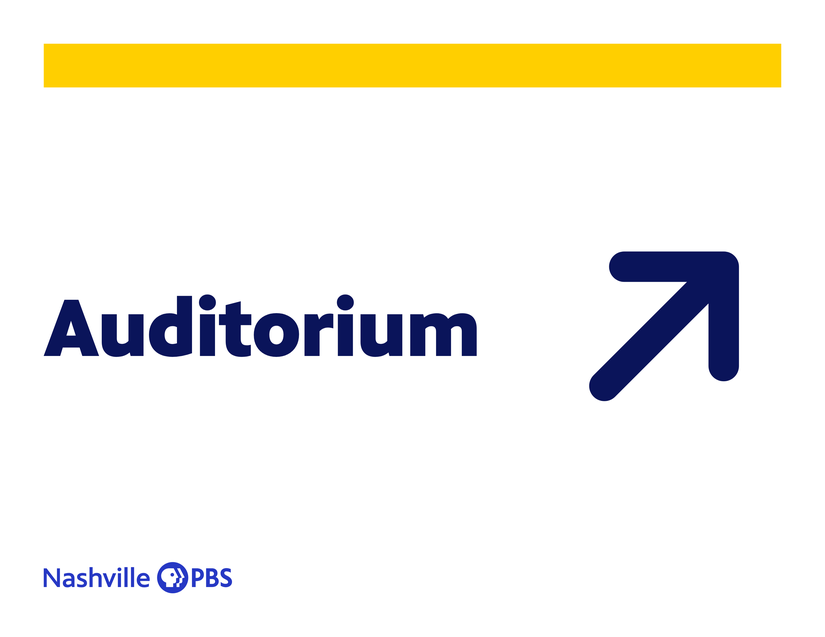 |
| Partner logos, three shapes<br>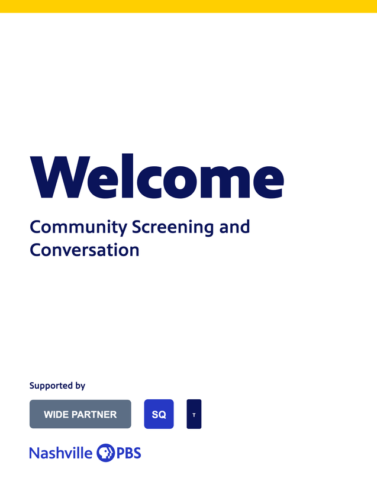 | Partner logos, seven, landscape<br>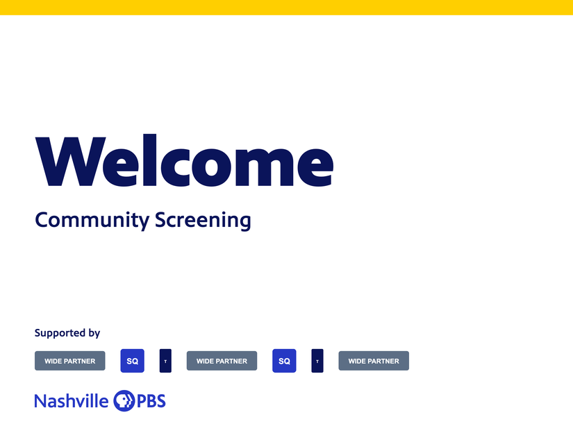 | Welcome on Navy (print shop)<br> |

## B10. No Word or PowerPoint template

Arial PowerPoint sign templates were built on 2026-11-07 at another session's request and removed the
same day: Shane, "having the generator now I don't see a reason to build a separate set of Word or
PowerPoint templates since they can go here and build it and get what they need." The generator is the
one way to make a sign; the brand page links it, not a file.

---

# Part C. Open for Shane (batched)

1. **Which end-card styles ship first.** All four in Part A are built and verified; the three in
   §A2.5 are not. Say which of the four go live now and whether any of the three should follow.
2. **Which signs ship first.** All eight in Part B are built and verified. Say which go live now
   (the custom sign alone covers most needs; the named ones save typing).
3. **Sponsor or underwriter logos on signs.** Built (Shane, 2026-11-07: "they could need partner
   logos", as a flex row that adapts as logos are added): the partner row in §B3, with a plain label
   and the logos smaller than the station lockup, which keeps the sign noncommercial.
4. **Support-card facts**: confirmed by Shane on 2026-11-07 ("the support card is correct with the
   number and link").
5. **Art direction defaults** (§A5, §B7): fine print at 40px, rail at 3 columns, field at 5 rows, the
   PBS KIDS file, the sign band at 28px with Yellow. Silence keeps them.
6. **The photography notice's wording**: the station's approved text, supplied by Shane on
   2026-11-07, is in the tool and the template.

---

# Part D. Hosting: the move to graphics.wnpt.app

Shane, 2026-11-07, via the design-system session: "Yes, move it." The studio leaves public GitHub
Pages for `graphics.wnpt.app` behind Cloudflare Access, like the other staff tools. The hostname is
the default the session picked because Shane now calls the tool the station's graphics studio; it is
renameable (shane.md). What changes, and why, is recorded in `docs/DECISIONS.md`; the steps and their
evidence in `PROGRESS.md`. Live since 2026-11-07 17:53 UTC; the old address redirects since 17:58.

- **Serving.** A static-assets Worker (`wrangler.toml` at the repo root, name `wnpt-graphics`) serves
  the repository itself on the custom domain; `.assetsignore` keeps git metadata, the proxy, scripts
  and docs out of the upload (105 files). `npm run deploy` is the deploy; the custom-domain route
  provisions DNS and the certificate (the hub's mechanism). DNS for `graphics.wnpt.app` was empty on
  2026-11-07 and the zone has no wildcard: no collision.
- **The gate.** The Access application "Nashville PBS Graphics Studio" for `graphics.wnpt.app`, staff
  policy (@wnpt.org), defined in wnpt-events `scripts/setup-access.mjs` like the other sites and
  created by that repo's `access.yml` workflow. Outside editors are not added by hand: the brand-site
  session's self-service agency tool will manage this application's policy; when it does, the
  setup-access entry must be deleted (its comment says so). The route stays off until the
  application exists, so the hostname is never public.
- **The Airtable proxy** takes a comma-separated `ALLOW_ORIGIN` (worker/wrangler.toml `[vars]`) and
  echoes the matching origin; the GitHub Pages origin stays on the list until its redirect is
  confirmed, then comes off.
- **The hub** tile (NashvillePBS/wnpt-hub `src/apps.ts`) points at the new address once it is live.
- **GitHub Pages** becomes a redirect: the Pages source moves to a `gh-pages` branch that holds only
  a redirect page (and a `404.html` that keeps the path, so a bookmark to a generator lands on the
  same generator), so the Pages site no longer serves the tool or the PBS Sans files. The repo itself
  stays public until Shane makes it private, the one click that takes the font files off github.com
  too; Pages cannot then serve the redirect on the org's plan, which is why it is his call.
